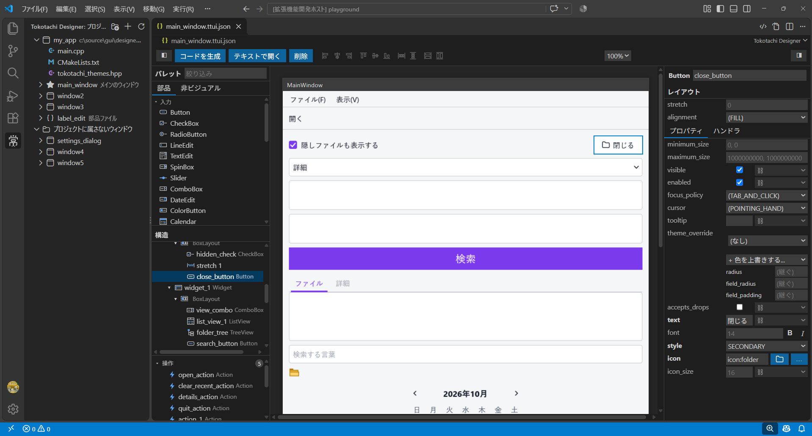
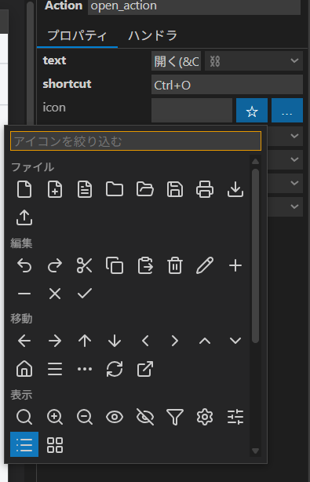
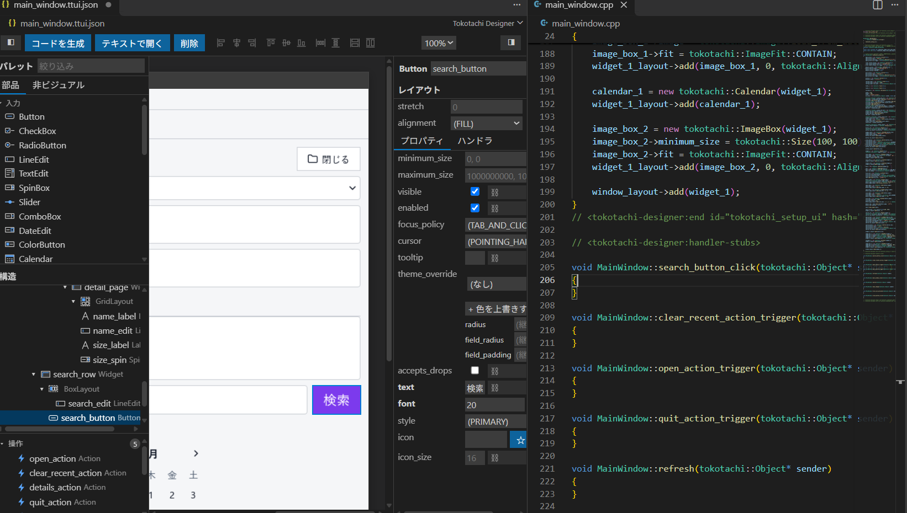

# Tokotachi Designer

[English](README.md)

クロスプラットフォームの C++11 の GUI ライブラリ [Tokotachi](https://github.com/okano-tomoyuki/tokotachi) の、画面を見ながら作る GUI デザイナーです。
ウィンドウをドラッグ＆ドロップで組み、読みやすい C++ のクラスを生成します。生成したコードには、そのまま手でハンドラを書き足せます。

## できること

- **作ったとおりに見える。** キャンバスは Tokotachi 自身(WebAssembly にしたもの)が描くので、ビルドしたアプリと同じ見た目
  (文字・配置・テーマ)になります。
- **レイアウトでも、自由な配置でも。** パレットの部品を縦横・格子のレイアウトに落とすか、自由に置いて整列の道具で揃えます。
  選ぶのは、クリック・範囲で囲む・構造の木から。
- **型に合ったインスペクタ。** 色・文字の書体・テーマの上書き・日付・画像・ほかの部品への参照など、プロパティの型に合った入力欄で
  編集し、ハンドラをつなぎ、プロパティを変数に結びつけます。
- **よく使うアイコン。** ボタン・メニュー・ツールバーに、よく使うアイコン約 70 個([Lucide](https://lucide.dev/))から選べます。
  部品の文字の色で塗るので、ダークのテーマでも画像を用意する必要がありません。

  

- **メニュー・ツールバー・Action。** ショートカットを付け、メニューバーとツールバーで共有します。
- **使い回し。** 部品の組み合わせを部品ファイルにして、ほかのウィンドウに置けます。C++ で書いた自作部品も、プロジェクトに
  ヘッダを登録するとパレットに出ます。
- **自分のものとして育てられる C++ を生成。** ウィンドウごとにクラス(`MainWindow : public tokotachi::Window`)を生成します。
  生成し直すのはマーカーで囲んだ区間だけで、書いたハンドラ・include は残り、新しいハンドラの雛形は決まった場所に足されます。
  「Generate Code」か、保存するたびに生成します。

  

- **プロジェクト。** プロジェクトファイルにウィンドウを並べると、`main.cpp` と `CMakeLists.txt` も生成するので、すぐにビルドできます。
  共通のテーマを登録して見本で確かめられます。
- **書いているそばから問題を表示。** 正しくない値・切れた参照・無いファイルを問題パネルに出します。定義ファイルはスキーマ付きの
  JSON なので、テキストとしても編集できます。

## 始め方

1. フォルダを開き、コマンドパレットの **Tokotachi Designer: New Project...**(またはアクティビティバーの Tokotachi Designer の
   **New Project**)を実行して、プロジェクトの名前を入れます(CMake のターゲットの名前にもなります)。
2. メインのウィンドウ(`main_window.ttui.json`)がデザイナーで開きます。パレットの部品をキャンバスにドラッグし、
   部品をダブルクリックすると、その部品の主なハンドラのコードを書けます。
3. 保存すると、ウィンドウのクラス・`main.cpp`・`CMakeLists.txt` を生成します。
4. CMake でビルドします。生成した `CMakeLists.txt` は `find_package(tokotachi)` を使います。ライブラリの入れ方は
   [Tokotachi の README](https://github.com/okano-tomoyuki/tokotachi#readme) を見てください。

## 必要なもの

- 画面を設計するだけなら、拡張のほかには何も要りません。
- 生成したコードをビルドするには、C++11 のコンパイラ、CMake 3.16 以降、Tokotachi のライブラリが要ります。

## 設定

| 設定                                       | 既定           | 内容                                                         |
| ------------------------------------------ | -------------- | ------------------------------------------------------------ |
| `tokotachiDesigner.codegen.generateOnSave` | `true`         | 定義ファイルを保存したときに C++ のコードを生成する。        |
| `tokotachiDesigner.codegen.commentLocale`  | `en`           | 生成するコードのコメントの言語(`en` か `ja`)。               |
| `tokotachiDesigner.codegen.namespace`      | (なし)         | 生成するクラスの名前空間(例: `app::ui`)。                    |
| `tokotachiDesigner.codegen.headerDir`      | (同じフォルダ) | 生成するヘッダのフォルダ(定義ファイルからの相対パス)。       |
| `tokotachiDesigner.codegen.sourceDir`      | (同じフォルダ) | 生成するソースのフォルダ(定義ファイルからの相対パス)。       |
| `tokotachiDesigner.canvas.colorScheme`     | `auto`         | キャンバスの配色。`auto` は VS Code の配色テーマに合わせる。 |

プロジェクトに属するウィンドウは、これらの代わりにプロジェクトファイルのコード生成の設定を使います。

## コマンド

| コマンド                              | 内容                                                    |
| ------------------------------------- | ------------------------------------------------------- |
| New Project...                        | メインのウィンドウを持つプロジェクトを作る。            |
| New Window... / New Component File... | ウィンドウの定義ファイル・使い回す部品ファイルを作る。  |
| Generate Code / Generate Project      | ウィンドウ・プロジェクト全体の C++ のコードを生成する。 |
| Open as Text                          | 定義ファイルをテキストのエディタで開く。                |

## 言語

画面は英語と日本語に対応しています(VS Code の表示言語に従います)。

## ライセンス

[MIT](LICENSE)。拡張には他者のソフトウェア(WebAssembly にした Tokotachi のライブラリとその依存、[Lucide](https://lucide.dev/) の
アイコン、JavaScript のパッケージ)が含まれます。[THIRD_PARTY_LICENSES.txt](THIRD_PARTY_LICENSES.txt) を見てください。
